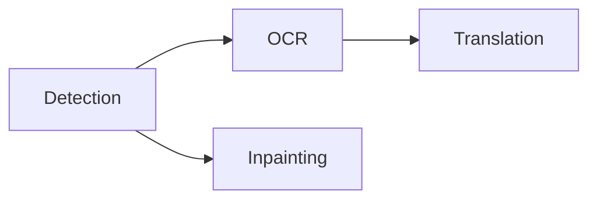

# Pipeline, Rendering, and Desktop Composition

## Fixed pipeline

`koharu-pipeline` coordinates a small named workflow rather than a runtime graph:

An execution unit is one stage on one page. Pages enter in project order, and once detection commits for a page that page's later branches become ready immediately — there is no global barrier that waits for every page's detection. OCR, translation, and inpainting therefore interleave across pages.

Each stage produces a semantic scene patch. The application commits it immediately, synchronizes the current canvas, and groups all revisions from one invocation into one undo step.

## Scheduling and residency

Accelerator inference uses one admission lane because representative heterogeneous overlap reduced throughput through compute and memory-bandwidth contention. CPU-only execution can retain independent per-model lanes.

Models load on demand and stay resident for reuse. A stage's model is released once its work has drained — no job of that stage is still running and none remains — so a model can outlive a single page, and models of overlapping stages can be resident at once. Failure and stop close the unfinished jobs, then release what is still resident; the failure path may unload first. Remote translation has no local model, so its release reports that nothing was resident. A stage that runs out of device memory is retried once after the other models are unloaded.

A page's decoded image cache lives from detection through inpainting: it is dropped when that page finishes every stage, and every cache is cleared when the run ends. Overlapping jobs may still decode from a cache another stage has already finished with, so per-stage cleanup would only force a re-decode. CPU execution still has no accelerator admission lane.

Stopping is cooperative. No new stage starts after the stop request; an active native call returns safely, and its result is discarded if it has not committed.

## Retained rendering

`koharu-renderer::Renderer` turns a scene snapshot and page ID into one immutable `Frame`. The frame contains ordered retained layers, entity lookup, presentation metadata, dependencies, diagnostics, and vector scenes.

Scene translation is the only visible text source. Typography, fit relations, fonts, images, visibility, and opacity all come from scene data. The renderer loads resources and retains reusable nodes; callers do not provide an alternate document model.

The canvas, flattened PNG, layer crops, and PSD adapter consume this same frame. Incremental renderer updates reuse unchanged nodes but must produce the same result as a complete render.

## Desktop composition

The WebView draws interface chrome, menus, controls, and inspectors. It stays transparent over the canvas region. Native WGPU/Vello output is composed beneath it in the same desktop window.

Validate visual changes through the final desktop window. A WebView screenshot alone cannot prove that native canvas pixels are present, and a native render alone cannot prove that transparency and interface composition are correct.

On Windows, the development WebView2 endpoint is `http://127.0.0.1:4000`; use semantic CDP inspection for the web layer and native window capture for the final composite.
